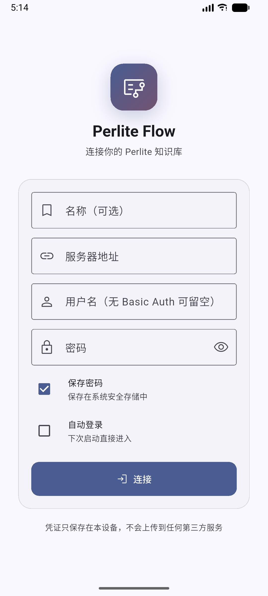

# Perlite Flow

A third-party Android client for [Perlite](https://github.com/secure-77/Perlite) — the self-hosted, web-based Obsidian vault viewer. Built with Flutter, Material 3, and zero server-side changes.



## What it does

- **Pure client.** Speaks Perlite's existing HTTP API (`index.php` + `content.php?mdfile|search|home`). No extra backend, no plugin install.
- **Server profile + Basic Auth.** First launch asks for the Perlite URL and Nginx basic-auth credentials. Saved in `flutter_secure_storage`, optional auto-login.
- **File tree.** Parses the vault's navigation DOM into a native file browser. Pull-to-refresh, filename + content search.
- **Reading view.** Reuses Perlite's rendered HTML inside `InAppWebView` so KaTeX, Mermaid, code highlighting and image attachments render exactly like the web app.
- **Search.** Debounced input, IME composition-aware, hit-highlighted excerpts straight from the server response.
- **Material 3 throughout.** Dynamic color (Material You) on Android 12+, manual seed palette otherwise, light/dark/auto theme, bundled reader fonts, and adjustable reader font scale.

## Why

Perlite's web UI is great on a desktop browser, but on a phone it means tapping tiny sidebar items inside Chrome. Perlite Flow keeps the server untouched and gives you a real Android app — with a proper file tree, pull-to-refresh, safe credential storage, and reading controls that aren't squeezed into a webview toolbar.

## Requirements

- Android 7.0+ (`minSdk 24`)
- A running Perlite instance. If you're using Nginx basic-auth in front of it, Perlite Flow supports that natively.

## Build

```sh
flutter pub get
flutter run            # debug
flutter build apk      # release
```

### Release APKs

`build-apk.ps1` builds one APK per CPU architecture and writes them to `dist/`:

```text
perlite-flow-v1.3.2-b1520000-arm64-v8a.apk
perlite-flow-v1.3.2-b1520000-armeabi-v7a.apk
perlite-flow-v1.3.2-b1520000-x86_64.apk
```

Most modern phones use `arm64-v8a`. `SHA256SUMS.txt` contains checksums.

### Release signing

`build-apk.ps1` expects `android/key.properties` plus `android/app/release.keystore`. Both are `.gitignore`d — generate your own:

```sh
keytool -genkey -v -keystore android\app\release.keystore `
        -keyalg RSA -keysize 2048 -validity 10000 -alias perlite_flow
```

```properties
# android/key.properties
storePassword=...
keyPassword=...
keyAlias=perlite_flow
storeFile=release.keystore
```

### GitHub Actions

`.github/workflows/android.yml` analyzes, tests, and builds split APKs on pushes, pull requests, and manual runs. Download them from the workflow run's artifacts. When `main` contains a new `pubspec.yaml` version, CI creates the matching `v<version>` GitHub Release and attaches signed APKs. Later pushes with the same version only upload workflow artifacts; bump the version to publish again.

For releases signed with the same key as local builds, add these repository secrets:

- `ANDROID_KEYSTORE_BASE64`
- `ANDROID_KEYSTORE_PASSWORD`
- `ANDROID_KEY_ALIAS`
- `ANDROID_KEY_PASSWORD`

Without signing secrets, branch builds use debug signing and release publishing fails.

## Test

```sh
flutter test                                        # unit + parsing tests
flutter test integration_test\real_server_test.dart --dart-define=PERLITE_USER=... --dart-define=PERLITE_PASSWORD=...
```

The `test/real_*.html` fixtures are snapshots of a real vault's index/search page — they're `.gitignore`d because they contain user note titles. To regenerate:

```sh
curl -u user:pass https://your-perlite.example/ > test\real_index.html
curl -u user:pass "https://your-perlite.example/content.php?search=foo" > test\real_search.html
```

## Project layout

```
lib/
  models/      server_profile, file_node, search_result
  services/    perlite_client (Dio + html parser), credential_store,
               note_cache, dynamic_color_service
  state/       app_state, theme_state
  pages/       login, home, reader, settings
  widgets/     file_tree, note_webview, search_excerpt_text
integration_test/  raw_socket_test, real_server_test
test/              unit tests + offline-vault parsing tests
```

## License

AGPL-3.0. See `LICENSE`. Perlite itself is AGPL-3.0 — the same license keeps this client compatible and keeps improvements upstream.

## Contributing

See `CONTRIBUTING.md`.
