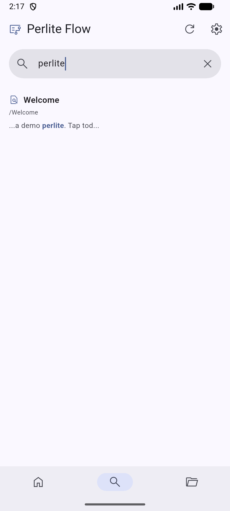
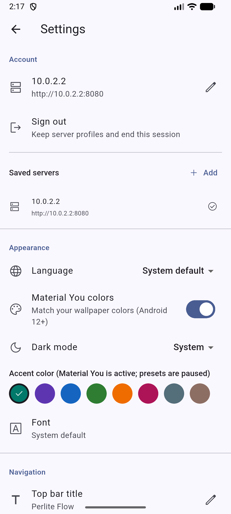

<p align="center">
  
</p>

<h1 align="center">Perlite Flow</h1>

<p align="center">
  A fast, native Android reader for your self-hosted Perlite vault.
</p>

<p align="center">
  <a href="https://github.com/Rosatus/perlite-flow/releases/latest"></a>
  <a href="https://github.com/Rosatus/perlite-flow/actions/workflows/android.yml"></a>
  <a href="LICENSE"></a>
  
</p>

<p align="center">
  <a href="https://github.com/Rosatus/perlite-flow/releases/latest"><strong>Download APK</strong></a>
  ·
  <a href="#features">Features</a>
  ·
  <a href="#build-from-source">Build</a>
  ·
  <a href="CONTRIBUTING.md">Contribute</a>
</p>

<p align="center">
  English · 简体中文 · 日本語
</p>

---

Perlite Flow turns a [Perlite](https://github.com/secure-77/Perlite) site into a
comfortable Android app. Browse your Obsidian vault with a native file tree,
search across notes, and read rendered Markdown without changing anything on
your server.

<p align="center">
  
  
  
</p>

## Features

- **No server changes.** Connects to the HTML endpoints Perlite already exposes.
- **Native vault browsing.** Folders, notes, canvas files, and attachments in a mobile-first tree.
- **Fast search.** Debounced, IME-aware search with highlighted excerpts.
- **Faithful reading.** Perlite-rendered HTML with images, links, code blocks, KaTeX, and Mermaid support.
- **Offline-friendly cache.** Recently opened notes appear instantly and refresh in the background.
- **Private by design.** Passwords stay in Android secure storage; there are no analytics or third-party services.
- **Multiple servers.** Save several Perlite instances, with optional HTTP Basic Auth and auto sign-in.
- **Made for your phone.** Material 3, Material You colors, dark mode, adjustable reader size, and customizable tabs.
- **Bundled fonts.** Choose LXGW WenKai or JetBrains Mono without downloading fonts at runtime.
- **Three languages.** English, Simplified Chinese, and Japanese, with in-app or system language selection.

## Install

1. Open the [latest release](https://github.com/Rosatus/perlite-flow/releases/latest).
2. Download the APK for your device:

| Your device | APK |
| --- | --- |
| Most phones from the last several years | `arm64-v8a` |
| Older 32-bit ARM phones | `armeabi-v7a` |
| x86_64 emulators and Chromebooks | `x86_64` |

3. Open the APK and allow installation from your browser or file manager if Android asks.

Each release includes `SHA256SUMS.txt`. Release APKs are signed with this
certificate:

```text
SHA-256: 2F:9C:FF:5A:2C:9D:D4:D9:7D:D2:CB:58:95:10:50:1A:37:CE:0B:E0:79:06:18:99:B6:28:F9:59:3C:8D:85:90
```

You can update in place as long as the certificate matches. To get updates
automatically from GitHub Releases, add this repository to
[Obtainium](https://github.com/ImranR98/Obtainium).

## Getting started

1. Enter your Perlite URL, such as `https://notes.example.com`.
2. If your server uses HTTP Basic Auth, enter the username and password.
3. Choose whether to save the password and sign in automatically next time.
4. Tap **Connect**.

Perlite Flow checks the URL as you type and explains common DNS, TLS, network,
and authentication errors.

## Requirements

- Android 7.0 or later
- A reachable Perlite instance
- Optional: HTTP Basic Auth in front of Perlite

Plain HTTP is allowed for local and LAN servers. Use HTTPS for servers reachable
from the internet.

## Privacy

Perlite Flow talks only to the servers you configure. Server profiles and app
preferences are stored locally. Saved passwords use Android secure storage.
Cached notes stay in the app's private storage and can be cleared from Settings.

## Build from source

Requirements: Flutter stable, Android SDK, and JDK 21.

```sh
git clone https://github.com/Rosatus/perlite-flow.git
cd perlite-flow
flutter pub get
flutter run
```

Run the checks used by CI:

```sh
flutter analyze
flutter test
```

On Windows, build the release APKs with:

```powershell
.\build-apk.ps1
```

The script builds one APK per ABI and writes files such as
`perlite-flow-v1.3.2-b1473223-arm64-v8a.apk` and `SHA256SUMS.txt` to `dist/`.
Local release builds read the gitignored `android/key.properties` and
`android/app/release.keystore`.

## Releases

GitHub Actions analyzes, tests, and builds every push and pull request. When
`main` contains a new `version` in `pubspec.yaml`, CI creates the matching
`v<version>` release and attaches signed APKs. Pushes with an existing version
only upload workflow artifacts.

To publish a release:

1. Bump `version` in `pubspec.yaml`, for example `1.3.3+10`.
2. Merge or push the change to `main`.
3. Wait for the **Android APK** workflow to publish `v1.3.3`.

Release signing uses these repository secrets:

- `ANDROID_KEYSTORE_BASE64`
- `ANDROID_KEYSTORE_PASSWORD`
- `ANDROID_KEY_ALIAS`
- `ANDROID_KEY_PASSWORD`

## Translations

Translations live in `lib/l10n/`:

- `app_en.arb` - English source strings
- `app_zh.arb` - Simplified Chinese
- `app_ja.arb` - Japanese

Add new strings to `app_en.arb` first, translate them in the other files, then
run `flutter gen-l10n` or `flutter pub get`.

## Project structure

```text
lib/
  l10n/       localization resources and helpers
  models/     server profiles, file tree, search results
  pages/      login, home, reader, settings
  services/   Perlite HTTP client, credential storage, cache
  state/      app, theme, and UI preferences
  widgets/    file tree, note WebView, search excerpts
test/         unit, widget, parser, and localization tests
tool/         release packaging helpers
```

## Contributing

Bug reports, translations, and pull requests are welcome. Please read
[CONTRIBUTING.md](CONTRIBUTING.md) before opening a PR.

## License

Perlite Flow is licensed under [AGPL-3.0](LICENSE), the same license as Perlite.
Bundled fonts keep their own licenses: LXGW WenKai and JetBrains Mono are both
distributed under the SIL Open Font License 1.1. See
`assets/fonts/LXGWWenKai-OFL.txt` for the WenKai license text.
